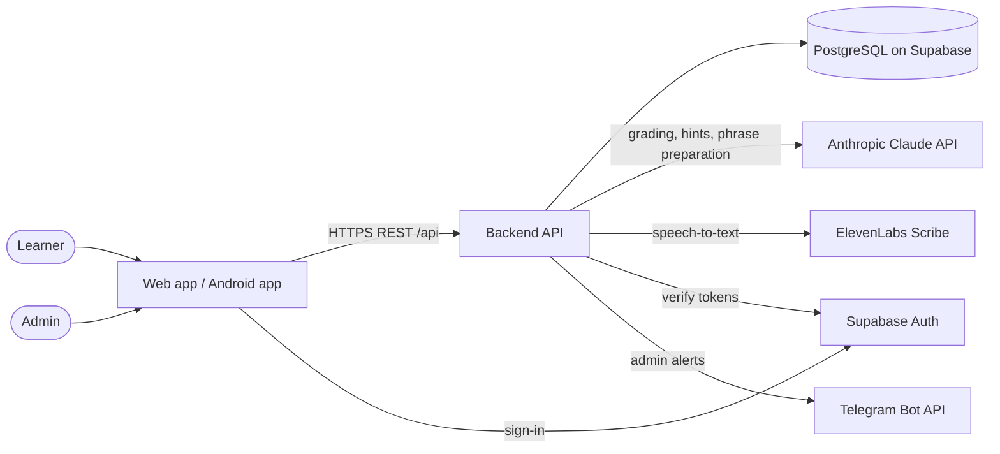

# System overview

## Purpose

A speaking trainer for adults learning conversational Turkish at CEFR level A2. The learner sees a short phrase in Russian or English, says it in Turkish, and gets an immediate score with an explanation. Phrases the learner gets wrong come back on a spaced-repetition schedule. The aim is fast, natural production of phrases, not knowledge of rules.

Working product name: **TurkTalk** (placeholder, see [ADR-0005](decisions/ADR-0005-working-brand.md)).

## Users

| User | What they do |
|---|---|
| Learner (free) | Practises preset topics by voice or typing, within a daily limit |
| Learner (Premium) | Higher daily limit; creates personal topics and phrases |
| Admin | Reviews payments, sees users and spend, switches debugging on |
| Store reviewer | Signs in with a dedicated review login |

## Context

The client never talks to Claude, ElevenLabs or the database directly. Provider keys exist only in the backend environment.

## Core learning loop

1. The learner picks a topic.
2. The backend returns an exercise: a source phrase in Russian or English, with tappable word hints.
3. The learner records an answer. The backend transcribes it. The learner may correct the transcript.
4. The backend grades the answer. An answer that exactly matches an accepted variant is scored without any AI call.
5. The learner sees a score, a verdict and an expandable breakdown.
6. The learner model and the phrase's review schedule are updated.

## Quality attribute requirements

These drive the architecture. Each names the mechanism that satisfies it.

| ID | Quality | Requirement | Mechanism |
|---|---|---|---|
| Q-1 | Cost | Total AI spend across all providers never exceeds $25 per calendar month (UTC), within one call's worst-case cost | Budget guard and usage ledger on every AI call ([budget-guard](interfaces/budget-guard.md)) |
| Q-2 | Cost | A single user cannot exhaust the shared budget | Per-user daily quota on every AI entry point |
| Q-3 | Privacy | Learner audio is not stored | Audio held in memory only for the transcription call; the one documented debug exception is in [constraints.md](constraints.md) (C-06) |
| Q-4 | Security | Provider keys never reach a client | Keys only in backend environment; clients call the backend |
| Q-5 | Modifiability | An AI provider or model can be replaced without touching business logic | Provider ports with one adapter per provider; model ids and prices from configuration |
| Q-6 | Correctness | Program logic never depends on unvalidated model output | Every model response is parsed into a Pydantic schema |
| Q-7 | Availability | When AI is unavailable or the budget is spent, the app still opens and explains the state | Typed error codes from the backend; exact-match grading needs no AI |
| Q-8 | Performance | A spoken answer is transcribed and graded fast enough to keep practice flowing; the backend function limit is 60 s | Timeouts and bounded retries per call; no model call on exact matches |
| Q-9 | Portability | One client codebase serves web and Android | Capacitor wraps the same React build |
| Q-10 | Usability | Interface is consistent, accessible and available in Russian and English | Design tokens and shared components; every string in both locales; Impeccable and axe checks |

## Scope boundaries

In scope: phrase translation practice by voice or text, review scheduling, statistics, personal content, manual Premium payments, admin tools.

Not in scope: free conversation, text-to-speech playback, phoneme-level pronunciation scoring, realtime (WebRTC) voice, in-app purchase through a payment provider. Adding any of these is an architectural change and needs an owner decision.
