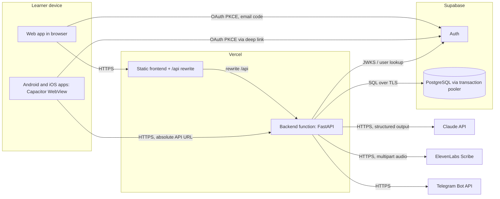

# Component-and-connector view: runtime

Shows what runs and how the running parts communicate.

## Primary presentation

## Element catalog

| Component | Role | Status |
|---|---|---|
| Web app | React single-page app; records audio with `MediaRecorder` | Existing |
| Android app | The same build inside a Capacitor WebView; calls the backend by absolute URL | Existing |
| iOS app | The same build inside a Capacitor WKWebView, like the Android app; adds Sign in with Apple through Supabase (ADR-0013) | New |
| Static frontend | Serves the build; rewrites `/api/*` to the backend | Existing |
| Backend function | Stateless FastAPI app, one invocation per request, 60 s limit | Existing |
| PostgreSQL | All persistent state, including the usage ledger | Existing |
| Supabase Auth | Issues user tokens (Google, Apple in the iOS app, email code, review password) | Existing; Apple added by ADR-0013 |
| Claude API | Grading, hints, phrase preparation, topic handling | Existing; not yet exercised against the live service |
| ElevenLabs Scribe | Speech-to-text | Existing; not yet exercised against the live service |
| Telegram | Admin notifications, including budget alerts | Existing |

| Connector | Properties |
|---|---|
| Client → backend | HTTPS REST, JSON and multipart; bearer token, `X-Interface-Language`, `X-Request-ID` on every request |
| Backend → database | psycopg 3 through the transaction pooler; prepared statements off; small pool because instances are short-lived |
| Backend → AI providers | HTTPS, synchronous, with timeout and bounded retries; always inside the budget guard |

## Context

Everything outside Vercel and Supabase is a third-party service the project does not control. No component other than the backend function holds a provider key.

## Variability guide

- Local development replaces PostgreSQL with SQLite and can replace both AI providers with fakes.
- Testlab replaces Supabase Auth with a local fixture.
- The Android and iOS apps' API URL is fixed at build time.

## Rationale

The backend is stateless so it fits serverless hosting. That is also why the spend cap is stored in the database and not held in memory: instances do not share memory, and a counter kept in one instance would let others overspend.
