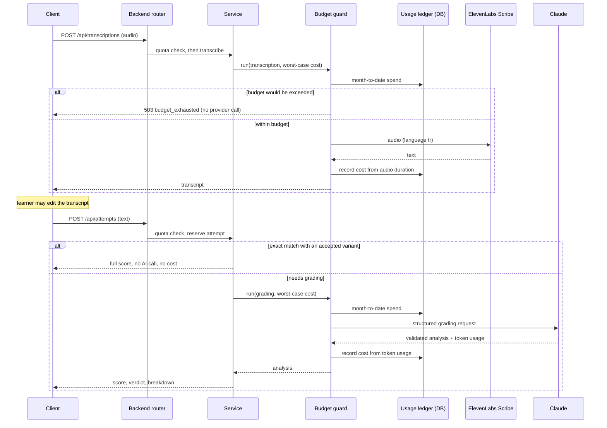

# Component-and-connector view: one spoken answer

Shows the path of a single spoken answer and every point where spending is checked. The spend checks shown exist today. The Turkish text rules in the exact-match step arrive in Phase 3.

## Primary presentation

## Element catalog

| Step | Behaviour | Status |
|---|---|---|
| Quota check | Daily phrase quota on grading, and the per-user daily spend limit on every AI call | Existing |
| Budget check | Refuses the call if month-to-date spend, or this user's spend today, plus this call's worst case exceeds its limit | Existing |
| Transcription | Audio is held in memory for the call and then released | Existing |
| Exact match | Normalised comparison using Turkish rules; no AI. Look-alike Cyrillic letters inside Latin words are repaired first | Existing |
| Grading | Structured output validated against `AnswerAnalysis`; unknown skills discarded | Existing |
| Cost recording | One ledger row per provider call, from measured usage | Existing |
| Idempotency | An attempt is reserved with a lease so a retried request is not graded or charged twice | Existing |

## Context

Soft hints, if the learner has them on, add a second guarded Claude call inside the transcription request. It follows the same check-call-record pattern.

## Variability guide

- Budget amount, prices and model ids are configuration.
- With the budget spent, typed or spoken answers that match exactly still work; everything that needs a provider returns `budget_exhausted`.

## Rationale

Checking before the call, with the worst case, is what bounds the overshoot to at most one call per concurrent request. Recording after the call, from measured usage, keeps the ledger accurate. See [budget-guard.md](../interfaces/budget-guard.md).
