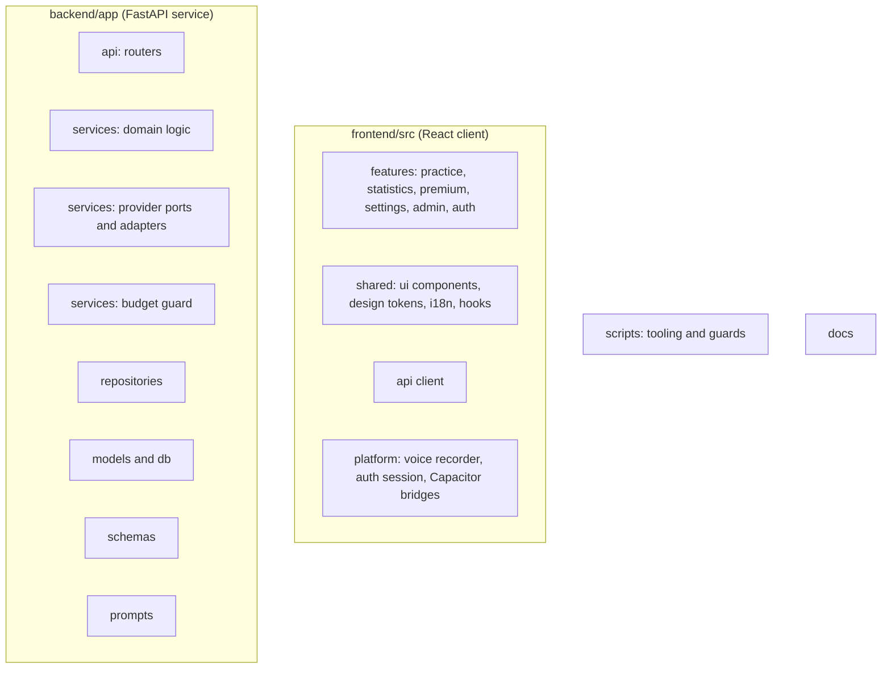

# Module view: decomposition

Shows which modules exist and what each is responsible for.

## Primary presentation

## Element catalog

### Backend (`backend/app`)

| Module | Responsibility | Status |
|---|---|---|
| `api/` | One router per resource. Validates requests, resolves dependencies, calls services, maps domain errors to HTTP | Existing |
| `schemas/` | Pydantic models for requests, responses and validated model output | Existing |
| `services/` domain | `attempt_service`, `answer_analyzer`, `session_service`, `topic_service`, `review_service`, `exercise_generator`, `scheduler`, `learner_model`, `statistics_service`, `word_hints`, `hint_alignment`, `payments`, `auth_service`, `feedback`, `account_deletion` | Existing |
| `services/` text policy | `turkish_text.py`: Turkish casing, alphabet check and normalisation for comparison | Existing |
| `services/` provider ports | `StructuredAIProvider`, `TranscriptionProvider`, `TranscriptionAssistanceProvider` protocols | Existing |
| `services/` adapters | `anthropic_adapter.py` (Claude) and `elevenlabs_adapter.py` (Scribe), one per provider, each implementing a port | Existing |
| `services/budget_guard.py`, `services/ai_usage.py` | Checks the monthly budget and the per-user daily limit before an AI call, records measured cost after it, alerts the admin at thresholds | Existing |
| `services/notifications.py` | Telegram messages to the admin | Existing |
| `services/failure_diagnostics.py`, `model_debug.py`, `debug_mode.py` | Safe error classification and the debug-admin diagnostics | Existing |
| `repositories/` | All database queries and transaction handling, one module per aggregate | Existing, including `usage.py` for the ledger |
| `models/` | SQLAlchemy entities | Existing, including `ai_usage_events` |
| `db/` | Engine and session setup, seed CLI, seeded catalogue (topics, phrases, hints, skills) | Existing; content re-authored in Turkish (Phase 3) |
| `prompts/` | Versioned prompt files, Turkish versions written in English (ADR-0007) | Existing |
| `config.py` | Settings read from the environment | Existing, including provider, price and budget settings |

### Frontend (`frontend/src`)

| Module | Responsibility | Status |
|---|---|---|
| `App.tsx` | Currently holds navigation, state and most screens in one component | Changing: split into the modules below (Phase 4) |
| `features/<name>/` | One folder per screen area: practice, statistics, premium, settings, admin, auth. Owns its components, hooks and queries | Planned (Phase 4) |
| `shared/ui/` | Reusable components built on design tokens | Planned (Phase 4); today components are flat files in `src/` |
| `shared/i18n/` | Keyed translations in Russian and English | Changing: today `i18n.ts` uses the Russian string as the key (Phase 4) |
| `api/` | Typed functions for every backend endpoint; the only place that calls `fetch` | Existing |
| platform | `voiceRecorder.ts`, `auth.ts`, `emailAuth.ts`, reward audio, Capacitor plugins | Existing; kept as is |
| `serbianScript.ts` | Latin/Cyrillic conversion | Changing: removed with the alphabet toggle (Phase 4); the backend no longer accepts the `alphabet` field |
| `landing-entry.tsx`, `LandingPage.tsx` | Marketing page, separate HTML entry | Existing |
| `android/` | Capacitor Android project | Existing; re-identified in Phase 5 |

### Outside the two applications

| Module | Responsibility | Status |
|---|---|---|
| `scripts/guard/` | Secret scanning used by the pre-commit hook and CI | Existing |
| `scripts/testing/` | Testlab, benchmarks and audits | Existing |
| `scripts/*.ps1` | Windows-only build and launch scripts | Changing: replaced by a cross-platform `justfile` (Phase 1) |
| `docs/architecture/` | This documentation | Existing |

## Context

The two applications share no code. They are coupled only through the REST contract in [rest-api.md](../interfaces/rest-api.md).

## Variability guide

- Which adapter implements each port is chosen by configuration, not by callers.
- Preset content is data in `db/`; adding a topic or phrase is a content change, not a structural one.
- A new screen is a new folder under `features/`.

## Rationale

The backend split predates this project and already separates HTTP, rules and persistence; the plan keeps it and closes the gaps (provider leaks, missing cost control). The frontend split is new and exists because a single 1,092-line component cannot be changed safely. See [ADR-0003](../decisions/ADR-0003-frontend-upgrade-in-place.md).
