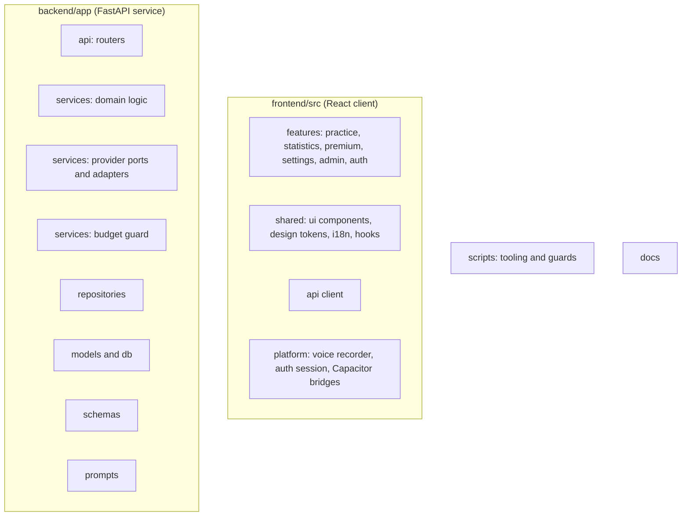

# Module view: decomposition

Shows which modules exist and what each is responsible for.

## Primary presentation

## Element catalog

### Backend (`backend/app`)

| Module | Responsibility | Status |
|---|---|---|
| `api/` | One router per resource. Validates requests, resolves dependencies, calls services, maps domain errors to HTTP | Existing |
| `schemas/` | Pydantic models for requests, responses and validated model output | Existing |
| `services/` domain | `attempt_service`, `answer_analyzer`, `session_service`, `topic_service`, `review_service`, `exercise_generator`, `scheduler`, `learner_model`, `statistics_service`, `word_hints`, `hint_alignment`, `payments`, `auth_service`, `feedback`, `account_deletion` | Existing |
| `services/` text policy | `turkish_text.py`: Turkish casing, alphabet check and normalisation for comparison | Existing |
| `services/` provider ports | `StructuredAIProvider`, `TranscriptionProvider`, `TranscriptionAssistanceProvider` protocols | Existing |
| `services/` adapters | `anthropic_adapter.py` (Claude) and `elevenlabs_adapter.py` (Scribe), one per provider, each implementing a port | Existing |
| `services/budget_guard.py`, `services/ai_usage.py` | Checks the monthly budget and the per-user daily limit before an AI call, records measured cost after it, alerts the admin at thresholds | Existing |
| `services/notifications.py` | Telegram messages to the admin | Existing |
| `services/failure_diagnostics.py`, `model_debug.py`, `debug_mode.py` | Safe error classification and the debug-admin diagnostics | Existing |
| `repositories/` | All database queries and transaction handling, one module per aggregate | Existing, including `usage.py` for the ledger |
| `models/` | SQLAlchemy entities | Existing, including `ai_usage_events` |
| `db/` | Engine and session setup, seed CLI, seeded catalogue (topics, phrases, hints, skills). The phrase catalogue is authored once in `db/catalog_tr/` (one module per topic: Russian and English source, canonical Turkish, hints for both languages, skills); `topic_phrases`, `topic_phrase_hints`, `topic_phrases_en`, `topic_phrase_hints_en` and `misc_phrases` are derived from it | Existing; Turkish content authored (Phase 3), pending native-speaker review |
| `prompts/` | Versioned prompt files, Turkish versions written in English (ADR-0007) | Existing |
| `config.py` | Settings read from the environment | Existing, including provider, price and budget settings |

### Frontend (`frontend/src`)

| Module | Responsibility | Status |
|---|---|---|
| `App.tsx` | Composes the signed-in app: section navigation (through `useSection`), app lifecycle (Android back button, visibility, account refresh) and rendering | Changing: split into the modules below (Phase 4); practice state and logic moved to `features/practice/`; App.tsx keeps navigation between sections, app lifecycle (back button, visibility, account refresh) and rendering |
| `appRouter.tsx`, `useSection.ts` | TanStack Router holding the current section (hash history in the browser, memory history on Android; ADR-0009) and the hook that reads and changes it | Done (Phase 4) |
| `features/<name>/` | One folder per screen area: shell, practice, statistics, premium, settings, admin, auth. Owns its components, hooks and queries | In progress (Phase 4): `features/practice/` holds the practice components (phrase with hints, answer and voice controls, result); `features/shell/` holds the desktop and phone headers, the topic chooser and the stage states (welcome, session done, review done); `features/statistics/` holds the weekly activity and phrase list with their own requests. Word-hint state and its request races live in `features/practice/useWordHints.ts`, recording and transcription in `features/practice/useVoiceAnswer.ts`, and the session (catalogue, startup phrase, checking, next phrase) in `features/practice/usePracticeSession.ts`; navigation and app lifecycle stay in `App.tsx`. `features/auth/` holds `AuthGate` (session restore, account load, sign-in card) and the sign-in styles shared with the landing page. |
| `shared/ui/`, `shared/lib/`, `shared/styles/` | Reusable components (shadcn/ui pattern on Radix: Button, Card, Switch, RadioGroup, Input, Select, Textarea, Field; the app's line icons), the `cn` class helper, the per-account TanStack Query client (`QueryProvider`), and the design tokens (`shared/styles/tokens.css`, Tailwind v4 `@theme`) | In progress (Phase 4): Settings, practice, the shell, statistics, Premium and the custom topic and phrase forms use them (`shared/ui/input.tsx` adds Input, Select, Textarea and Field), as do the Settings sub-sections (share, feedback, admin tools) and the admin users and payments pages, the login card (`features/auth/authStyles.ts`, shared with the landing sign-in) and the legal pages. The payment form, the reward overlay and the landing page are still flat files in `src/` styled by the legacy stylesheet, whose colours now resolve to the tokens |
| `shared/i18n/` | Keyed translations in Russian and English | In progress (Phase 4): `src/i18n.ts` runs i18next over `src/locales/{ru,en}/ui.json` (stable keys, Russian plural forms) and keeps the legacy Russian-as-key dictionary (`src/locales/en.json`) only for text that arrives as Russian content (preset topic titles, model feedback, phrase catalogue) and for the landing and legal pages, which are rewritten in Phase 5. All application interface strings use keys |
| `api/` | Typed functions for every backend endpoint; the only place that calls `fetch` | Existing |
| platform | `voiceRecorder.ts`, `auth.ts`, `emailAuth.ts`, reward audio, Capacitor plugins | Existing; kept as is |
| `landing-entry.tsx`, `LandingPage.tsx` | Marketing page, separate HTML entry | Existing |
| `android/` | Capacitor Android project | Existing; re-identified in Phase 5 |
| `ios/` | Capacitor iOS project: `Info.plist` microphone text and the auth link scheme (ADR-0013) | New |

### Outside the two applications

| Module | Responsibility | Status |
|---|---|---|
| `scripts/guard/` | Secret scanning used by the pre-commit hook and CI | Existing |
| `scripts/testing/` | Testlab, benchmarks and audits | Existing |
| `scripts/*.ps1` | Windows-only build and launch scripts | Changing: replaced by a cross-platform `justfile` (Phase 1) |
| `docs/architecture/` | This documentation | Existing |

## Context

The two applications share no code. They are coupled only through the REST contract in [rest-api.md](../interfaces/rest-api.md).

## Variability guide

- Which adapter implements each port is chosen by configuration, not by callers.
- Preset content is data in `db/catalog_tr/`; adding a topic or phrase is a content change, not a structural one. After a change run `just content-export` to regenerate `frontend/src/locales/phrases.en.json`; a backend test fails while that file is out of date.
- A new screen is a new folder under `features/`.

## Rationale

The backend split predates this project and already separates HTTP, rules and persistence; the plan keeps it and closes the gaps (provider leaks, missing cost control). The frontend split is new and exists because a single 1,092-line component cannot be changed safely. See [ADR-0003](../decisions/ADR-0003-frontend-upgrade-in-place.md).
