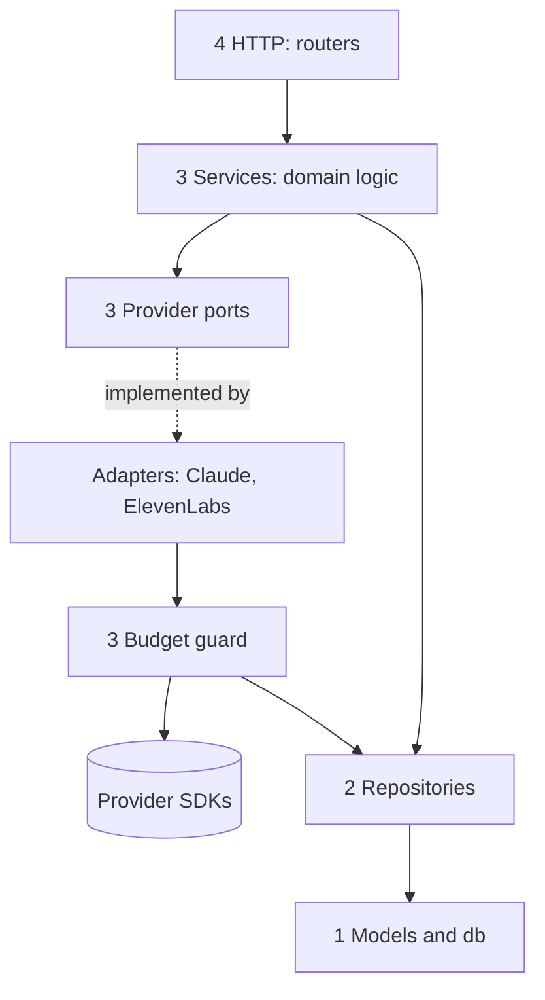

# Module view: layers

Shows which direction dependencies are allowed to point. A module may use modules in its own layer or any layer below it, never above.

## Primary presentation

### Backend

| Layer | Modules | May depend on |
|---|---|---|
| 4. HTTP | `app/api`, `app/main.py`, middleware | 3, 2, 1, schemas |
| 3. Services | `app/services` (domain logic, ports, budget guard) | 2, 1, schemas, prompts |
| 2. Repositories | `app/repositories` | 1 |
| 1b. Models | `app/models` | 1a |
| 1a. Database setup | `app/db` (engine, session, declarative base) | nothing above |
| Side: Schemas | `app/schemas` | nothing in layers 1 to 4 |
| Side: Adapters | provider adapter modules inside `app/services` | ports, schemas, a provider SDK |

Additional rules inside the services layer:

- Domain services depend on **ports**, never on adapters.
- Adapters are the only modules that import a provider SDK.
- An adapter never calls its provider directly. It hands the call to the budget guard, which checks the budget, makes the call and records the cost. Because the guard sits inside the adapter, a service that obtains an adapter by any route is still guarded.

### Frontend (target, Phase 4)

| Layer | Modules | May depend on |
|---|---|---|
| 4. App shell | routes, providers, entry points | 3, 2, 1 |
| 3. Features | `features/*` | 2, 1; never another feature |
| 2. Shared | `shared/ui`, `shared/i18n`, hooks, platform helpers | 1 |
| 1. API client and types | `api/`, `types/` | nothing above |

## Element catalog

See [module-decomposition.md](module-decomposition.md) for what each module does. This view adds only the allowed-to-use relation.

## Context

Layer rules apply within each application. Between applications the only relation is HTTP.

## Variability guide

None. Layer direction is fixed. A change that needs an upward dependency is an escalation case.

## Rationale

- Keeping rules out of routers lets them be tested without HTTP.
- Keeping SDK imports in adapters is what makes a provider replaceable (quality Q-5).
- Routing every provider call through one guard is what makes the spend cap a property of the structure instead of a convention each endpoint must remember (quality Q-1). See [ADR-0002](../decisions/ADR-0002-global-monthly-spend-cap.md).

## Known deviations today

These exist in the code now and are removed in the phase shown. Do not add more.

| Deviation | Removed in |
|---|---|
| `transcription_service.py` and `ai_adapter.py` test for concrete OpenAI classes with `isinstance` | Phase 3 |
| Legacy OpenAI adapters (`OpenAIStructuredProvider`, `OpenAITranscriptionProvider`) remain in the code, unguarded, but are no longer wired into the application; they exist only for tests not yet ported | Phase 3 |
| `transcription_service.py` takes a FastAPI `UploadFile` (listed as an ignored import in the C-03 contract) | Phase 3 |
| `db/seed.py` imports repositories and models. It is an offline tool, not part of the request path, and is a permanent, documented exception in the C-01 contract | n/a |
| Frontend has no layers; `App.tsx` mixes all four | Phase 4 |
